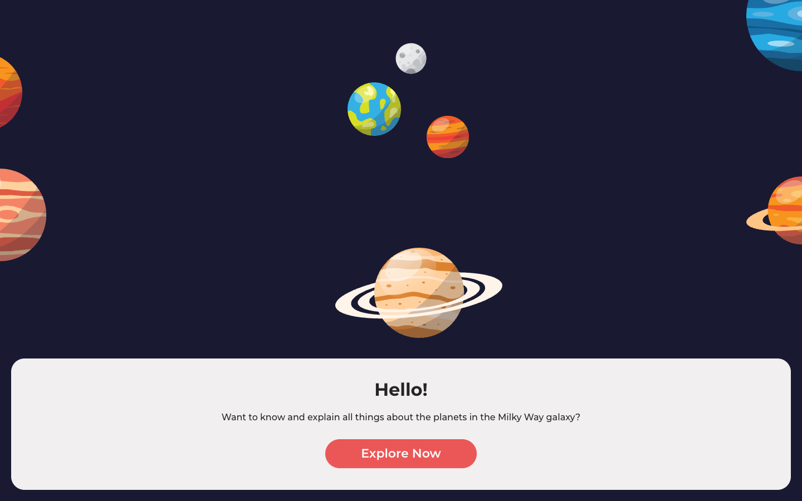
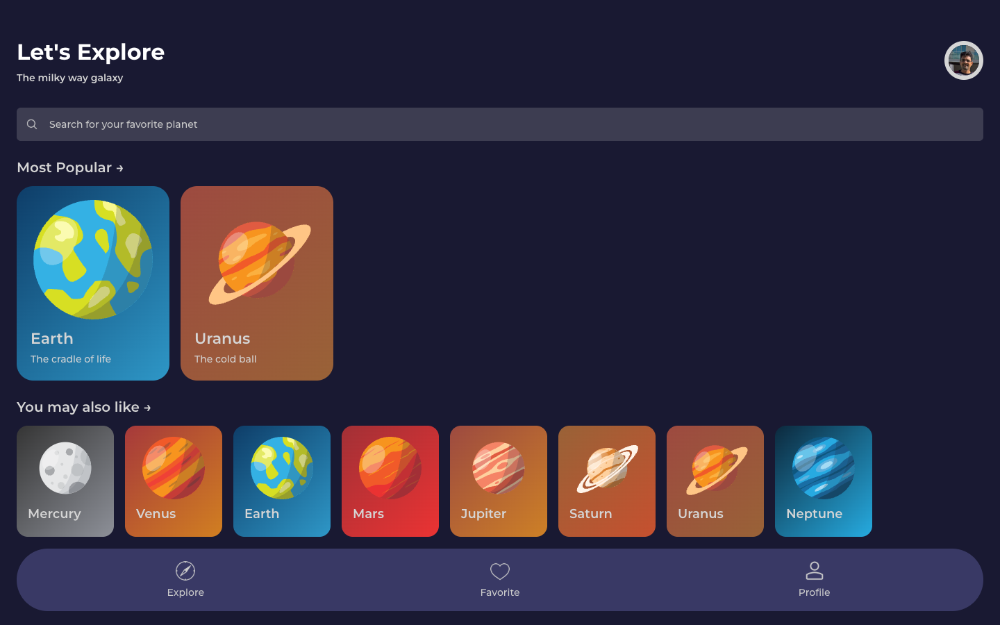
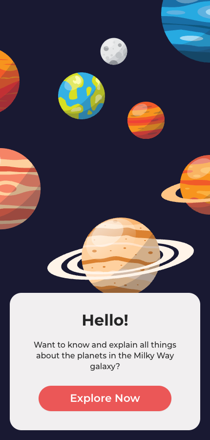

# MauiPlanets, running in the browser with MauiWeb

[naweed/MauiPlanets](https://github.com/naweed/MauiPlanets) is a .NET MAUI UI showcase by Naweed Akram (MIT).
This repository is the same app, moved to **.NET 11 / .NET MAUI 11.0.0**, with one extra project that serves it
as a website through [MauiWeb](https://mauiweb.appmare.com). The pages, view models, styles and animations are
untouched: the browser gets real HTML rendered on the server, and every tap runs the app's own C#.

| Start page | After "Explore Now" | Phone width |
| --- | --- | --- |
|  |  |  |

**Try it live:** https://live.mauiweb.appmare.com/planets (also in the [MauiWeb live gallery](https://mauiweb.appmare.com/gallery.html)'s Samples section).

## Run it

Requirements: the .NET 11 SDK and the .NET MAUI 11 workload (`dotnet workload install maui`).

```bash
dotnet run --project src/MauiPlanets.Web
```

Open <http://localhost:5321>. MauiWeb is free on localhost, `.local`, `.test` and private hosts; a public
domain needs a licence (see the [pricing](https://mauiweb.appmare.com)).

The phone heads are still there: `src/MauiPlanets` targets `net11.0-android`, `net11.0-ios` and
`net11.0-maccatalyst` as before.

## What changed from the original

1. **`src/MauiPlanets/MauiPlanets.csproj`** — targets moved from `net6.0-*` to `net11.0-*`, a plain `net11.0`
   target added (built as a library, so the web host can reference it), the obsolete `Microsoft.Maui.Extensions`
   / `Microsoft.Maui.Dependencies` packages replaced by `Microsoft.Maui.Controls` 11.0.0.
2. **`src/MauiPlanets/MauiProgram.cs`** — `CreateMauiApp` takes an optional `Action<MauiAppBuilder>` so a host
   can add its own setup. The phone heads call it with no argument, as before.
3. **`src/MauiPlanets.Web/`** (new) — an empty ASP.NET Core project with the `AppMare.MauiWeb` package and
   one line in `Program.cs`:

   ```csharp
   app.MapMauiWeb(() => MauiProgram.CreateMauiApp(b => b.UseMauiWeb()));
   ```

   plus an item group that copies the app's `Resources/` (fonts, images) next to the web host.

Nothing in `Views/`, `Models/` or `Services/` was edited.

## Licence

The app is MIT, © 2022 Naweed Akram (see [LICENSE](LICENSE)). The web host project added here is MIT too.
MauiWeb itself is a commercial package by [AppMare](https://appmare.com), free for local development.
